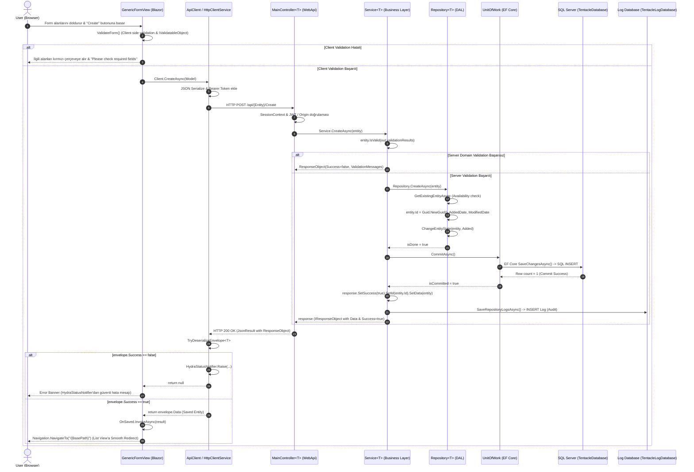

# Create Story: End-to-End Lifecycle of an Entity Creation in Hydra

Bu teknik doküman, modern ve modüler bir Hydra uygulamasında (referans: **Tentacle**) bir varlığın (örneğin `RequestCategory`, `Employee`, `Request`) son kullanıcının arayüzdeki `+ Create` butonuna basışından veritabanında (`SQL Server`) commit edilip arayüze başarılı dönüş yapmasına kadar geçen tam yaşam döngüsünü (Lifecycle) adım adım açıklar.

Ayrıca bu dokümanda, `RequestCategory` kaydı oluşturulurken yaşanan ve *"Veritabanında kayıt başarıyla oluştuğu halde ekranda neden 'Something went wrong. Save failed. Please check the required fields.' uyarısı çıktı?"* sorusunun kök neden analizi (Post-Mortem) ve mimari çözümü de detaylandırılmıştır.

---

## 1. Mimari Yaşam Döngüsü Özeti (Sequence Diagram)

Aşağıdaki şema, kullanıcı bir form doldurup **Create** butonuna bastığında isteğin katmanlar arasındaki geçişini ve response zarfının (ResponseObject Envelope) geri dönüşünü göstermektedir:



---

## 2. Katman Katman İstek Yolculuğu

### Katman 1: UI & Form Yönetimi (`GenericFormView.razor`)
1. **Meta-veri Güdümlü Form (Form Metadata):** Sayfa açılırken (`OnInitializedAsync`), ilgili entity'nin meta alanları (`TableDTO`) ve Dropdown seçenekleri dinamik olarak yüklenir.
2. **Çift Kalkanlı Client Doğrulaması (Dual-Shield Client Validation):**
   - Form kaydedilmeden önce `ValidateForm()` metodu tetiklenir.
   - **Adım 1:** Model `IValidatableObject` uyguluyorsa, backend kuralları derleme zamanında istemci tarafında da koşar (DRY prensibi).
   - **Adım 2:** `IsRequired` olan meta kolonlar denetlenir; boşluk tespit edilirse `_fieldErrors` sözlüğüne eklenir.
   - Hata varsa HTTP çağrısı hiç yapılmaz, ağ trafiği korunur ve kullanıcının hatalı alanları anında kırmızı sınırla vurgulanır.

### Katman 2: HTTP İletimi & Zarf Deseni (`ApiClient<T>` & `HttpClientService.cs`)
1. İstemci doğrulaması geçilince `ApiClient<T>.CreateAsync(Model)` çağrılır.
2. `HttpClientService.PostEnvelopeAsync<T>`:
   - `EnsureAuthorizationHeaderAsync()` ile oturum JWT token'ını ekler.
   - Modeli JSON olarak serileştirir (`_jsonOptions`).
   - WebApi'nin generic endpoint'ine `POST /api/{Entity}/Create` isteği gönderir.

### Katman 3: API Controller & Güvenlik (`MainController<T>.cs`)
1. `MainController<T>` ASP.NET Core generic controller tabanıdır.
2. `[HttpPost("Create")]` aksiyonu gövdeden `[FromBody] T entity` modelini alır.
3. Oturum, tenant ve CORS filtreleri (`SessionMiddleware`, IP/Origin izinleri) süzgecinden geçer.
4. İşi servis katmanına devreder: `var response = await Service.CreateAsync(entity);`.
5. Dönen sonuç HTTP yanıtına dönüştürülür:
   ```csharp
   return new JsonResult(response) { StatusCode = response.Success ? 200 : (response.StatusCode ?? 400) };
   ```

### Katman 4: İş Mantığı & Domain Doğrulama (`Service<T>.Command.cs`)
1. `var response = new ResponseObject().SetActionName("Create").SetId(entity.Id).UseDefaultMessages();` başlatılır.
2. **Server Domain Invariants:** `if (!entity.IsValid(out var validationResults))` ile sunucu doğrulaması çalışır. API dışarıdan doğrudan çağrılsa bile geçersiz veri içeri giremez.
3. `isDone = await Repository.CreateAsync(entity);` çalıştırılır.

### Katman 5: Veri Erişim Katmanı (`Repository<T>.Command.cs`)
1. **Varlık Tekillik Kontrolü:** `GetExistingEntityAsync` ile bu kaydın veritabanında zaten olup olmadığına bakılır. Varsa `Availability` hatası eklenir.
2. **Audit & Kimlik Ataması:**
   ```csharp
   entity.Id = entity.Id == Guid.Empty ? Guid.NewGuid() : entity.Id;
   entity.AddedDate = DateTime.Now;
   entity.ModifiedDate = DateTime.Now;
   ```
3. **EF Core State:** `ChangeEntityState(entity, EntityState.Added)` ile varlık ChangeTracker'a eklenir.
4. Başarı durumunda `RepositoryResult.Logs` içine `LogFactory.Info` ile Create audit kaydı hazırlanır.

### Katman 6: Unit of Work & Veritabanı (`UnitOfWork.cs` & `SQL Server`)
1. `Service.CreateAsync` içindeki `await CommitAsync()` çağrısı `UnitOfWork.CommitAsync()` metoduna gider.
2. EF Core `SaveChangesAsync()` tetiklenerek SQL Server'a `INSERT INTO [RequestCategory] ...` sorgusu iletilir.
3. **Hata Kalkanı (SqlExceptionHelper):**
   - Eğer SQL seviyesinde bir kısıt ihlali olursa (Duplicate Key 2627, Foreign Key 547, Null Constraint 515), `SqlExceptionHelper` devreye girer.
   - OWASP ve CWE-209 standartları gereğince veritabanı tablo/kolon şemaları kullanıcıya sızdırılmaz.
   - Güvenli, anlaşılır kullanıcı mesajı (`LastErrorSafeMessage`) oluşturulur ve teknik stack trace log veritabanına kaydedilir.

### Katman 7: Denetim İzi & Yanıt Zarfı Paketleme
1. İşlem başarılı olduğunda `response.SetSuccess(isDone && isCommitted)`.
2. Servis, oluşturulan varlığı ve yeni Id'yi yanıt zarfına yerleştirir:
   ```csharp
   response.SetId(entity.Id).SetData(entity);
   ```
3. `SaveRepositoryLogsAsync()` çalışarak `TentacleLogDatabase.dbo.Log` tablosuna audit logunu yazar.
4. Response JSON olarak Blazor istemcisine döner.

---

## 3. Post-Mortem Analizi: "Sahte Hata" (False Failure) Vakası

### Belirti (Symptom):
Kullanıcı `http://localhost:5121/RequestCategory/Create` ekranında `Sample category` kaydı oluşturduğunda:
- Ekranda kırmızı bir banner belirdi: *"Something went wrong. Save failed. Please check the required fields."*
- Ancak veritabanı sorgulandığında `RequestCategory` tablosuna kaydın eksiksiz eklendiği görüldü.
- Log tablosu (`TentacleLogDatabase.dbo.Log`) sorgulandığında `ProcessType = Create, Description = The creation process was successful` kaydı bulundu.

### Kök Neden (Root Cause Analysis):
Zincirleme iki mimari eksiklik tespit edildi:

1. **`Service.Command.cs` Eksik Payload Sözleşmesi:**
   `Service.CreateAsync` metodunda veritabanı commit işlemi başarılı olduğunda `response.SetSuccess(true)` çağrılıyordu fakat **`response.SetData(entity)` çağrılmıyordu!**
   Bu nedenle HTTP yanıtındaki `data` alanı `null` dönüyordu:
   ```json
   {
       "success": true,
       "id": "01a1b33c-e73e-71fd-b7a5-d476917006a1",
       "data": null,
       "messages": [...]
   }
   ```
2. **`HttpClientService` & `GenericFormView` Null Kontrolü:**
   - `HttpClientService.PostEnvelopeAsync<T>` metodu `envelope.Success == true` olsa bile `envelope.Data` alanını döndürüyordu. `Data == null` olduğu için `CreateAsync` çağrısı UI'a `null` döndü.
   - `GenericFormView.razor` içindeki Save mantığı:
     ```csharp
     var result = await Client.CreateAsync(Model);
     if (result != null)
     {
         Navigation.NavigateTo($"/{BasePath}");
     }
     else
     {
         ErrorMessage = "Save failed. Please check the required fields.";
     }
     ```
     `result` null geldiği için `else` bloğuna girdi ve arayüzde sahte hata banner'ını gösterdi!
3. **Hata Mesajının Yutulması:**
   Gerçek bir hata durumunda dahi `GenericFormView.razor`, sunucudan veya `HydraStatusNotifier`'dan gelen spesifik hata mesajlarını (`SqlExceptionHelper` güvenli mesajı, iş kuralları vb.) kontrol etmeyip sabit string basıyordu.

---

## 4. Uygulanan Mimari Çözümler

### 1. `Service.Command.cs` Veri Payload Garantisi
`CreateAsync`, `UpdateAsync` ve `DeleteAsync` metodlarında işlem başarıyla sonuçlandığında yanıt zarfına veri açıkça eklendi:
```csharp
// CreateAsync
if (response.Success)
{
    response.SetId(entity.Id).SetData(entity);
    await SaveRepositoryLogsAsync();
}

// UpdateAsync
if (updateResponse.Success)
{
    updateResponse.SetId(entity.Id).SetData(entity);
    await SaveRepositoryLogsAsync();
}

// DeleteAsync
if (response.Success)
{
    response.SetData(true);
    await SaveRepositoryLogsAsync();
}
```

### 2. `MainController.cs` HTTP Durum Senkronizasyonu
API Controller katmanında HTTP Status Code ile ResponseObject başarı durumu tam uyumlu hale getirildi:
```csharp
[HttpPost("Create")]
public virtual async Task<JsonResult> Create([FromBody] T entity)
{
    var response = await Service.CreateAsync(entity);
    return new JsonResult(response) { StatusCode = response.Success ? 200 : (response.StatusCode ?? 400) };
}
```

### 3. `GenericFormView.razor` Akıllı Hata ve Bildirim Entegrasyonu
`GenericFormView.razor` bileşeni `HydraStatusNotifier` ile entegre edildi. Artık bir hata oluştuğunda genel fallback yerine sunucunun ürettiği güvenli iş kuralı veya validasyon mesajı ekranda dinamik olarak gösterilmektedir:
```csharp
if (result != null)
{
    await OnSaved.InvokeAsync(result);
    Navigation.NavigateTo($"/{BasePath}");
}
else
{
    if (StatusNotifier?.Last != null &&
        StatusNotifier.Last.OccurredAt >= saveStartedAt.AddSeconds(-2) &&
        StatusNotifier.Last.Messages.Any())
    {
        ErrorMessage = string.Join(" ", StatusNotifier.Last.Messages);
    }
    else if (StatusNotifier?.Last?.Definition?.UserMessage != null &&
             StatusNotifier.Last.OccurredAt >= saveStartedAt.AddSeconds(-2))
    {
        ErrorMessage = StatusNotifier.Last.Definition.UserMessage;
    }
    else
    {
        ErrorMessage = "Save failed. Please check the required fields.";
    }
}
```

---

## 5. Kalite Standartları ve Prensipler Özeti
- **SOLID & Single Responsibility:** Her katman kendi sorumluluğunu yerine getirir (UI formu toplar, Service iş kuralını doğrular, UoW transaction'ı yönetir).
- **CWE-209 / OWASP Koruması:** `SqlExceptionHelper` sayesinde teknik veritabanı detayları asla dışarı sızmaz, kullanıcı dostu güvenli mesajlar arayüze iletilir.
- **Fail-Safe & Audit:** Her başarılı ve başarısız Create operasyonu `TentacleLogDatabase` üzerinde tam izlenebilirlikle denetlenir.
