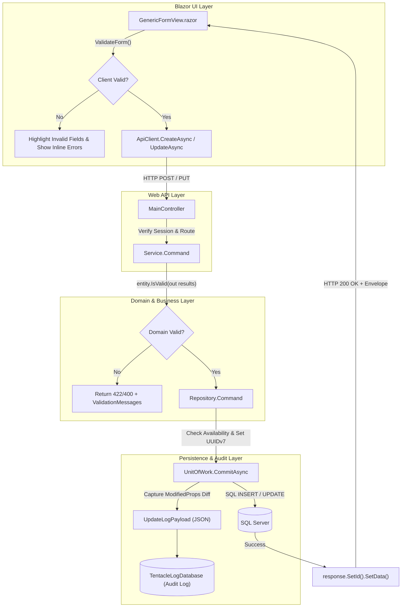

# GedenLines'tan Modern Hydra'ya: Create, Update, Validasyon ve Log Yönetimi Mimarisi

Bu doküman, önceki nesil kurumsal platformumuz **GedenLines** ile modern mikro-çekirdek mimarimiz **Hydra / Tentacle** arasındaki mimari evrimi inceler; Create ve Update süreçleri, validasyon yaşam döngüsü ve denetim izi (Audit Logging) konularında her iki sistemin en iyi pratiklerini sentezleyerek oluşturduğumuz yeni nesil mimari standartları belirler.

---

## 1. GedenLines Mirası ve Karşılaştırmalı Analiz

GedenLines projesi (`Business.GedenLines`, `DAL.GedenLines`, `Model.GedenLines`, `Blazor.GedenLines`), yıllar içinde yüksek veri hacmi ve karmaşık iş akışları altında test edilmiş çok değerli mimari desenler barındırır. Modern Hydra ekosistemine geçerken bu desenler modernize edilmiş, kısıtları giderilmiş ve zenginleştirilmiştir:

| Mimari Alan | GedenLines (Önceki Nesil) | Hydra / Tentacle (Modern Mimari) | Yeni Nesil En İyi Pratik (Sentez) |
|---|---|---|---|
| **Eşzamansızlık (Async)** | Senkron ağırlıklı (`bool Create(T entity)`), task wrap'leri. | Uçtan uca `async Task<IResponseObject>` ve modern `await`. | Tüm I/O ve veritabanı işlemleri non-blocking asenkron, `CancellationToken` uyumlu. |
| **Response Zarfı (Envelope)** | `ResponseObject`, `ResponseObjectForUpdate`. `SetData` controller'da çağrılıyordu. | `ResponseObject<T>` jenerik zarfı. `SetId` ve `SetData` doğrudan `Service.Command` katmanında garanti edilir. | Zarf hem nesnenin kendisini (`Data`), hem yeni `Id`'sini, hem de güvenli kullanıcı mesajlarını eksiksiz taşır. |
| **Validasyon Kalkanı** | `BaseObject.CheckIsValid()` ile `Validator.TryValidateObject`. | Çift Kalkan: İstemcide ve sunucuda `IValidatableObject` + `ValidationManager` (CWE-209 korumalı). | DRY prensibi: Aynı C# validasyon kuralları hem Blazor UI'da form göndermeden önce anlık çalışır hem de backend'de domain koruması sağlar. |
| **Form Bileşeni (UI)** | Ayrı `CreateViewComponent.razor` ve `EditViewComponent.razor`. Bootstrap col-3 grid. | Tek birleşik `GenericFormView.razor`. Meta-veri güdümlü CSS Grid. | Hem Create hem Edit'i tek yerden yöneten, reaktif hata temizleyen, kapatılabilir (dismissable) banner'lı akıllı form motoru. |
| **Güncelleme ve Idempotency** | Değişiklik yoksa `"This record has no modified field"` hatası dönüyordu. | Değişiklik yoksa işlem **idempotent başarı** kabul edilir (`isUpdated = true`). | Kullanıcı bir kaydı açıp hiçbir şey değiştirmeden kaydettiğinde kırmızı sahte hata basılmaz; işlem sessizce başarılı sayılır. |
| **Denetim İzi (Audit Logging)** | `UpdateLog : Log` (OldValue, NewValue string kolonları). `LogsToTrace` bellek tamponu. | `TentacleLogDatabase`, `EntityChangeSet` (JSON Payload), `LogFactory.Info`. | Hangi kullanıcının, hangi oturumda (`CorrelationId`), hangi alanları eski değerinden yeni değerine değiştirdiği yapısal JSON diff olarak loglanır. |

---

## 2. Uçtan Uca Create & Update Mimarisi

### 2.1. Backend Komut Mimarisi (CQRS & UoW)

Modern Hydra mimarisinde komutlar (`CreateAsync`, `UpdateAsync`, `DeleteAsync`), `Service.Command.cs` ve `Repository.Command.cs` üzerinden çalışır:



### 2.2. Idempotent Güncelleme Güvencesi
GedenLines'ta bir varlık güncellenirken hiçbir alanı değiştirilmediğinde sistem `isUpdated = false` dönüp kullanıcıya kırmızı bir hata uyarısı veriyordu. Modern Hydra'da bu mantık düzeltildi:

```csharp
if (HasAnyModifiedProperty(entity))
{
    entity.ModifiedDate = DateTime.Now;
    var modifiedProps = GetModifiedProperties(entity).ToArray();
    response.AddModifiedProperties(modifiedProps);

    // JSON formatında alan bazlı diff kaydı
    var changes = modifiedProps.Select(propName => new EntityChangeSet
    {
        Property = propName,
        OldValue = dbValues?[propName]?.ToString(),
        NewValue = entry.CurrentValues[propName]?.ToString()
    }).ToList();

    Result.Logs.Add(LogFactory.Info(category: TypeName, name: nameof(UpdateAsync), ...)
        .SetPayload(JsonSerializer.Serialize(new UpdateLogPayload { ... })));

    ChangeEntityState(entity, EntityState.Modified);
    isUpdated = true;
}
else
{
    // Değişiklik yoksa mevcut durum zaten hedeflenen durumdur (Idempotent Success)
    isUpdated = true;
}
```

---

## 3. Frontend Tasarımı ve Reaktif Validasyon (`GenericFormView.razor`)

GedenLines'ın `ResponseComponent` ve `CustomValidationMessageComponent` bileşenlerinden esinlenerek `GenericFormView.razor` üzerinde şu modernleştirmeler gerçekleştirildi:

1. **Reaktif Validasyon Temizleme (Reactive Error Clearing):**
   Kullanıcı formu kaydetmeye çalıştığında boş bırakılan zorunlu alanlar kırmızı çerçeveye alınır. Kullanıcı o alana bir karakter yazdığı anda `_fieldErrors.Remove(field.Name)` tetiklenir ve kırmızı çerçeve anında kaybolur.
2. **Kapatılabilir Bildirim Banner'ları (Dismissable Alerts):**
   Oluşan hata veya başarı mesajları için sağ üst köşede kapatma `(X)` butonu bulunur; kullanıcı bildirimi okuduktan sonra kapatabilir.
3. **Kutlama Ekranı ve Zengin Aksiyonlar (Celebration Screen & Post-Save Actions):**
   Kayıt başarıyla oluşturulduğunda kullanıcıyı aniden listeden dışarı atmak yerine, yeşil renkli animasyonlu bir **Kutlama Kartı** karşılar:
   - **"View Details" (Detayına Git):** Yeni oluşturulan kaydın detay sayfasına (`/{BasePath}/Details/{Id}`) tek tıkla geçiş sağlar.
   - **"Back to List" (Listeye Dön):** Liste görünümüne anında döner.
   - **"Create Another" (Yeni Ekle):** Formu temizleyip sıfırlayarak peş peşe hızlı veri girişi imkanı sunar.
   - **"Continue Editing" (Düzenlemeye Devam Et):** Edit modunda değişiklik sonrası formda kalıp düzenlemeye devam etmeyi sağlar.
   - **Otomatik Geri Sayım (Smart Auto-Redirect):** 5 saniyelik görsel geri sayım rozeti ("Redirecting to list in 5s... click to cancel") gösterilir; kullanıcı hiçbir şeye basmasa bile süre dolunca liste ekranına pürüzsüz yönlendirilir. İsterse rozete tıklayarak geri sayımı durdurup ekranda kalabilir.
4. **Çift Tıklama Koruması (Debounce & Double-Submit Prevention):**
   `IsSaving` bayrağı true olduğu anda buton devre dışı kalır ve animasyonlu spinner belirir; mükerrer ağ istekleri engellenir.

---

## 4. Denetim İzi ve Log Yönetimi Standartları

- **Korelasyon Takibi:** Her HTTP isteği `HydraContext.CorrelationId` ile damgalanır. UI'dan DB'ye kadar tüm loglar aynı CorrelationId ile birbirine bağlanır.
- **Fail-Safe Veri Güvenliği:** `TentacleLogDatabase` veritabanına erişilemediği nadir durumlarda `LogService`, logları sessizce `FileLogWriterService` üzerinden yerel diske yazar; uygulamanın çökmesi engellenir.
- **CWE-209 / OWASP Standardı:** Veritabanından fırlatılan `SqlException` hataları doğrudan kullanıcıya gösterilmez; `SqlExceptionHelper` ile güvenli iş mesajlarına dönüştürülür.
